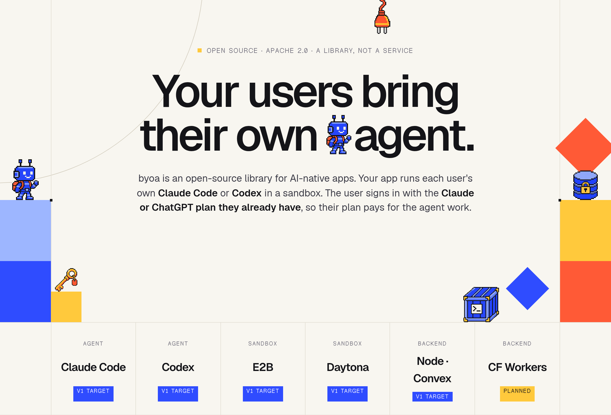

<a href="https://byoa.rippling.computer">
<picture>
  <source media="(prefers-color-scheme: dark)" srcset=".github/readme/banner-dark.png">
  
</picture>
</a>

<div align="center">

[Website](https://byoa.rippling.computer) · [Docs](https://byoa.rippling.computer/docs) · [Spec](SPEC.md) · [Example app](examples/todo) · [Agent skill](skills/byoa) · [llms.txt](https://byoa.rippling.computer/llms.txt) · [Contributing](CONTRIBUTING.md)

[](https://github.com/madeyexz/byoa/actions/workflows/ci.yml)


</div>

# byoa: bring your own agent

**byoa, short for "bring your own agent", is the simplest way to let your users bring their own AI subscription to power the agents in your app.**

AI is like electricity, and an AI subscription is like a portable battery pack: one pack powers every app its user uses. We bet that everyone will have one, and that every app will run on it. [The future of AI-native apps](https://byoa.rippling.computer/docs#the-future-of-ai-native-apps) explains why.

byoa is an open-source library that helps you build these apps fast. Your app runs the user's own Claude Code, Codex or Grok Build in a sandbox. The user signs in with their own ChatGPT, Claude or Grok plan, or gives the key of their OpenCode Go plan, so they pay for the AI work with a plan they already have. Your app passes on only the sandbox cost, so it can offer a frontier agent at a low price. The user connects each MCP tool (Notion, Gmail, and others) one time, and every agent run has it.

Version 1 supports three sandbox providers: E2B, Daytona and Instabox. More providers come later. To change the provider, you change one adapter.

## Who brings what

**Your app brings the product. Each user brings the agent.** You build the app and pick the sandbox. Each user brings their plan and their tools. byoa runs inside your backend and runs each job in that user's own sandbox.

<picture>
  <source media="(prefers-color-scheme: dark)" srcset=".github/readme/who-dark.png">
  
</picture>

The [Overview](https://byoa.rippling.computer/docs/concepts) page explains the diagram, how a job runs, and why real tokens never go into the sandbox.

## What works today

<picture>
  <source media="(prefers-color-scheme: dark)" srcset=".github/readme/scope-dark.png">
  
</picture>

## Agent skill

[skills/byoa](skills/byoa) teaches a coding agent (Claude Code, Codex, Amp and others) to add byoa to an app. After you install byoa, link the skill of your version into your app's repository:

```sh
npx skills experimental_sync -y
```

With byoa 1.0.0, or if that command does not work: `npx skills add madeyexz/byoa@v1.1.0 --skill byoa`. [Let a coding agent do it](https://byoa.rippling.computer/docs/getting-started#let-a-coding-agent-do-it) has the other ways to install it.

## Docs

The docs are at [byoa.rippling.computer/docs](https://byoa.rippling.computer/docs), from the Markdown files in [docs/](docs):

- [Getting started](https://byoa.rippling.computer/docs/getting-started): install, one `agents` object, two routes, a sign-in and a first job
- [Overview](https://byoa.rippling.computer/docs/concepts): who brings what, how a job runs, and why real tokens never go into the sandbox
- [Supported AI subscriptions](https://byoa.rippling.computer/docs/subscriptions) and the [FAQ](https://byoa.rippling.computer/docs/faq): which Claude, ChatGPT, Grok and OpenCode Go (beta) plans work, whether a user's account can get banned, and what a job costs
- [Give your agent tools](https://byoa.rippling.computer/docs/agent-tools): your app's own tools, MCP servers, skills and plugins, and which one to choose
- [AI login](https://byoa.rippling.computer/docs/ai-login): the sign-in, where the login stays between jobs, one job step by step, jobs at the same time with one login, and sign-out
- [Sandbox lifecycle](https://byoa.rippling.computer/docs/sandbox-lifecycle): every sandbox byoa creates, what each provider does, and what happens when your backend dies
- [MCP tools and the proxy](https://byoa.rippling.computer/docs/mcp): MCP connections, job tokens, your app's own tools, and calls with a user's grant
- [Running agents](https://byoa.rippling.computer/docs/running-agents): `agents.run` and its events, `access`, sandbox modes, conversations, jobs at the same time, models and effort, `session` and `jobToken`
- [Sandbox providers](https://byoa.rippling.computer/docs/providers) and [Stores and Convex](https://byoa.rippling.computer/docs/stores): E2B, Daytona, Instabox, Postgres, Convex, and your own
- [Testing](https://byoa.rippling.computer/docs/testing): the fake harness, the local sandbox and the memory store, and byoa's own tests
- [API reference](https://byoa.rippling.computer/docs/api), [Lab rules](https://byoa.rippling.computer/docs/lab-rules) and [Security](https://byoa.rippling.computer/docs/security)

What version 1 must do, and the checks that prove it, are in [SPEC.md](SPEC.md).

## Rules we follow

- We run the real, unmodified `claude`, `codex` and `grok` binaries. We never pretend to be another client.
- The user signs in through Anthropic's, OpenAI's or xAI's own sign-in page.
- One app's AI login is used only by that app.
- For OpenCode Go, byoa uses only the user's own key, with OpenCode's documented API and the harness's own user agent, never OpenCode's Console CLI sign-in. OpenCode's terms do not clearly allow an app to run it for its users; each app asks OpenCode first.
- The labs' terms restrict where an AI login may be stored. byoa keeps it in your database by default, so each app checks those terms and signs its own agreements with the labs. See [Lab rules](https://byoa.rippling.computer/docs/lab-rules) and [SPEC.md](SPEC.md#lab-rules).

## License

Apache License 2.0. See [LICENSE](LICENSE).

<a href="https://byoa.rippling.computer"></a>
