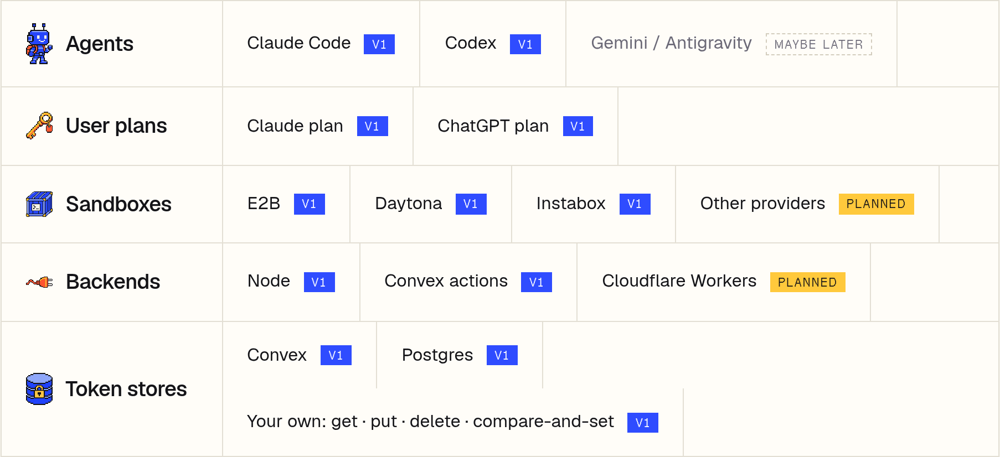
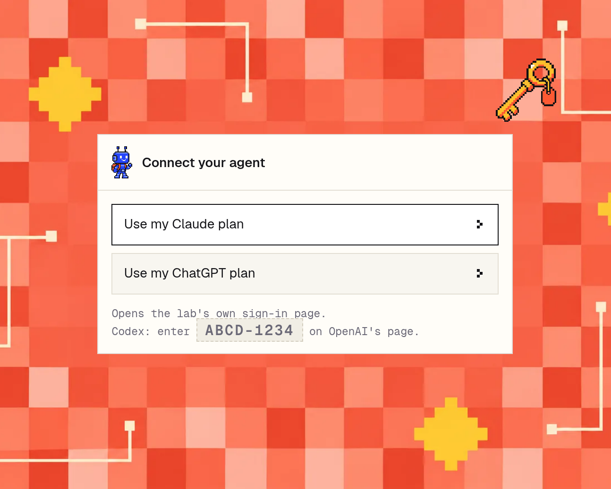
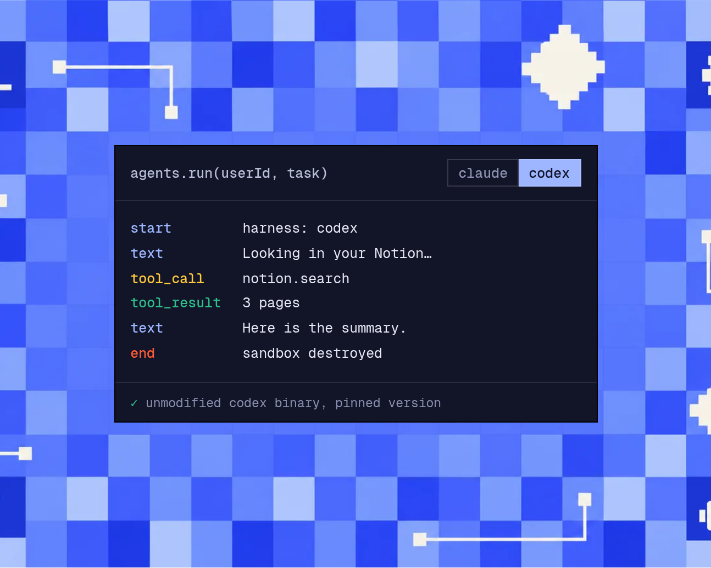
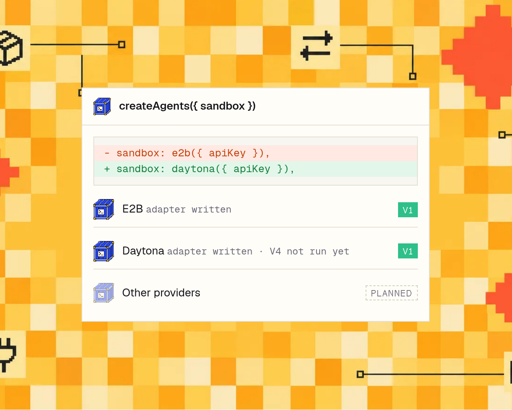
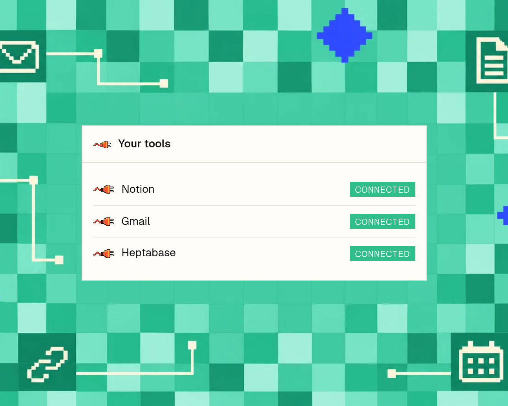
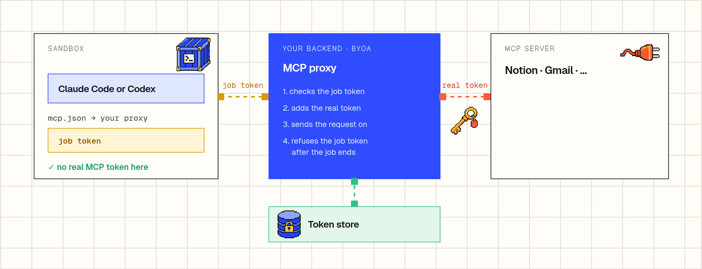
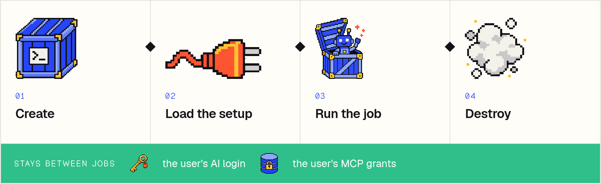
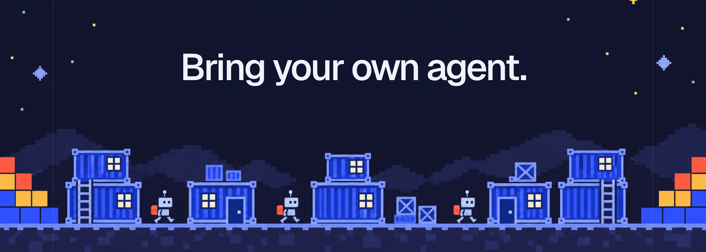

<a href="https://byoa.rippling.computer">
<picture>
  <source media="(prefers-color-scheme: dark)" srcset=".github/readme/banner-dark.png">
  
</picture>
</a>

<div align="center">

[Website](https://byoa.rippling.computer) · [Spec](SPEC.md) · [Example app](examples/todo) · [Agent skill](skills/byoa) · [llms.txt](https://byoa.rippling.computer/llms.txt) · [Contributing](CONTRIBUTING.md)

[](https://github.com/madeyexz/byoa/actions/workflows/ci.yml)


</div>

# byoa: bring your own agent

**byoa lets your app run each user's own Claude Code or Codex, on their plan and with their tools, in any sandbox, from inside your own backend.**

byoa is an open-source library that helps you build AI-native apps fast. Your app runs the user's own Claude Code or Codex in a sandbox. The user signs in with their own ChatGPT or Claude plan, so they pay for the AI work with a plan they already have. The user connects each MCP tool (Notion, Gmail, and others) one time, and every agent run has it.

Version 1 supports three sandbox providers: E2B, Daytona and Instabox. More providers come later. To change the provider, you change one adapter.

## Who brings what

**Your app brings the product. Each user brings the agent.** You build the app and pick the sandbox. Each user brings their plan and their tools. byoa runs inside your backend and runs each job in that user's own sandbox.

<picture>
  <source media="(prefers-color-scheme: dark)" srcset=".github/readme/who-dark.png">
  
</picture>

<details>
<summary>The same diagram as text</summary>

```text
DEVELOPER · YOU                                           END USER
┌────────────────────────────────────┐                    ┌────────────────────────────────────┐
│ builds the app                     │                    │ uses the app                       │
│ picks the sandbox provider         │                    │ has a Claude or ChatGPT plan       │
│ owns the database                  │                    │ has MCP tools and skills           │
└──────────────────┬─────────────────┘                    └──────────────────┬─────────────────┘
                   │ imports byoa             signs in on the lab's own page │
                   │                             connects each MCP tool once │
                   ▼                                                         ▼
┌─ YOUR APP'S BACKEND · you run it ────────────────────────────────────────────────────────────┐
│  your app code                                            your database                      │
│        │ agents.run(userId, task)                               ▲ AI logins, MCP grants      │
│        ▼                                                        │                            │
│ ┏━━━━━━━━━━━━━━━━━━━━━━━━━━━━━━━━━━━━━━━━━━━━━━━━━━━━━━━━━━━━━━━┻━━━━━━━━━━━━━━━━━━━━━━━━━━┓ │
│ ┃ byoa · open source, Apache 2.0                                                           ┃ │
│ ┃   AI login · harness            skills · AGENTS.md            MCP OAuth · proxy          ┃ │
│ ┃              │                                                           │               ┃ │
└─╂┄┄┄┄┄┄┄┄┄┄┄┄┄┄│┄┄┄┄┄┄┄┄┄┄┄ ▲ your backend · outside it ▼ ┄┄┄┄┄┄┄┄┄┄┄┄┄┄┄┄┄│┄┄┄┄┄┄┄┄┄┄┄┄┄┄┄╂─┘
  ┃              │ create · run · destroy                         real token │               ┃
  ┃              ▼                                                           ▼               ┃
  ┃ ┌─ SANDBOX ────────────────┐  ┌─ AI LABS ────────────────┐  ┌─ MCP SERVERS ────────────┐ ┃
  ┃ │ E2B or Daytona,          │  │ Anthropic · OpenAI       │  │ Notion · Gmail · …       │ ┃
  ┃ │ on your account          ├─▶│ model calls, paid by     │  │ the user's own accounts  │ ┃
  ┃ │ runs the user's own      │  │ the user's own plan      │  │                          │ ┃
  ┃ │ Claude Code or Codex     │  │                          │  │                          │ ┃
  ┃ └──────────────────────────┘  └──────────────────────────┘  └──────────────────────────┘ ┃
  ┃                                                                                          ┃
  ┗━━━━━━━━━━━━━━━━━━━━━━━━━━━━━━━━━━━━━━━━━━━━━━━━━━━━━━━━━━━━━━━━━━━━━━━━━━━━━━━━━━━━━━━━━━┛
```

</details>

## The problem

To make an app AI-native, you run a big lab's harness (Claude Code or Codex) in a sandbox, with the user's own AI plan. For each app, you must build the same connection layer again:

- the user's AI login, through the real CLI;
- the user's MCP connections and their OAuth tokens, with one refresh owner;
- the user's skills and AGENTS.md;
- the harness install and its updates;
- the code that connects all of this to one sandbox provider.

byoa is that layer, as a library, so you do not build it again for each app.


## What byoa is, and what it is not

- byoa **is** a library. It runs inside your app's own backend (Node or Convex). Cloudflare Workers support is planned.
- byoa **stores tokens in your own database**, through a store adapter.
- byoa **is not** a hosted service. We do not run a server, and we never see your users' tokens.

<picture>
  <source media="(prefers-color-scheme: dark)" srcset=".github/readme/scope-dark.png">
  
</picture>

## Why byoa

<table>
<tr>
<td width="50%" valign="top">

<h3>The user's plan pays.</h3>
Each user signs in with their own Claude or ChatGPT plan, on Anthropic's or OpenAI's own sign-in page. The agent work runs on that plan, not on your API bill.
</td>
<td width="50%" valign="top">

<h3>The real agents.</h3>
Your app runs the real, unmodified Claude Code and Codex. Users get the full harness, with their tools and skills.
</td>
</tr>
<tr>
<td width="50%" valign="top">

<h3>Any sandbox.</h3>
Each sandbox provider is one adapter with one interface. E2B, Daytona and Instabox come first. To change the provider, you change one line.
</td>
<td width="50%" valign="top">

<h3>Connect once.</h3>
The user connects each MCP tool one time. Every agent run has it. The real tokens never go into the sandbox.
</td>
</tr>
</table>

## How it works

byoa sits in your backend, between your users and their agents. Your app calls `agents.run(userId, task)`. byoa starts or resumes the user's sandbox, loads the user's setup, and runs the user's own harness on the user's own plan.

<picture>
  <source media="(prefers-color-scheme: dark)" srcset=".github/readme/how-dark.png">
  
</picture>

### Real tokens never go into the sandbox

The agent in the sandbox gets a short-lived job token. The proxy in your backend adds the real MCP token to each request.

<picture>
  <source media="(prefers-color-scheme: dark)" srcset=".github/readme/tokens-dark.png">
  
</picture>

### The sandbox of each job

<picture>
  <source media="(prefers-color-scheme: dark)" srcset=".github/readme/lifecycle-dark.png">
  
</picture>

The picture shows `sandboxPer: 'job'`. By default, step 1 resumes the user's sandbox from the last job (or creates it for the first job), and step 4 pauses it.

## Install

byoa is not on npm yet. Until version 1, install it from GitHub:

```sh
npm install github:madeyexz/byoa     # npm builds it on install
bun add github:madeyexz/byoa        # Bun loads its TypeScript source
```

From version 1: `npm install byoa` or `bun add byoa`. For E2B, also install `e2b`. byoa needs Node 22.18 or later, or Bun.

## Agent skill

[skills/byoa](skills/byoa) is a skill in the [Agent Skills](https://agentskills.io) format. It teaches a coding agent (Claude Code, Codex, Amp and others) to add byoa to an app: the install, `createAgents` with a store and a sandbox adapter, the sign-in, the MCP connections and their routes, `agents.run` and its events, and the lab rules. To install it in your app's repository:

```sh
npx skills add madeyexz/byoa              # Claude Code, Codex, Cursor and others
amp skill add madeyexz/byoa/skills/byoa   # Amp
```

For LLMs, the site also serves the docs as [llms.txt](https://byoa.rippling.computer/llms.txt) (an index) and [llms-full.txt](https://byoa.rippling.computer/llms-full.txt) (the README, SPEC.md, the example and the skill in one file).

## How it will look

This is the API in this repository today. It can change before version 1.

```ts
import { createAgents } from 'byoa'
import { e2b } from 'byoa/sandbox/e2b'
import { postgresStore } from 'byoa/store/postgres'

const agents = createAgents({
  app: 'myapp',                                    // one app's AI logins are only this app's
  sandbox: e2b({ apiKey }),
  store: postgresStore({ query: (sql, args) => pool.query(sql, args) }),
  encryptionKey,                                   // openssl rand -base64 32; grants and AI logins are encrypted with it
  proxyUrl: 'https://myapp.example.com/byoa/mcp',  // serve agents.proxy here
  oauth: { redirectUrl: 'https://myapp.example.com/byoa/callback' },
  tools: { todos: { add_todo: { description: 'Add one to-do.', input, run: ({ title }, { user }) => db.addTodo(user, title) } } },  // your app's own tools
})

const claude = await agents.connectLogin(userId, 'claude')  // { url }: Anthropic's own sign-in page
await agents.finishLogin(userId, 'claude', { code })        // the code that page shows
const codex = await agents.connectLogin(userId, 'codex')    // { url, code }: OpenAI's page and the code to enter
await agents.finishLogin(userId, 'codex', { waitMs: 60_000 })

const mcp = await agents.connectMcp(userId, 'https://mcp.notion.com/mcp', { name: 'notion' })
// mcp.signInUrl: the server's sign-in page; your redirectUrl route then calls agents.finishMcp({ state, code })

for await (const event of agents.run(userId, { harness: 'claude', task, mcp: ['notion', 'todos'], setup: { agentsMd, skills } })) {
  // start, text, tool_call, tool_result, permission, error, end: the same events for Claude Code and Codex
}
```

An app that runs its own program around the unmodified harness (for example its own server, which starts `claude` or `codex` itself) opens the job with `agents.session` instead. It gets the same sandbox, login, pinned harness and job token, and runs its own command:

```ts
const s = await agents.session(userId, { harness: 'claude', mcp: ['notion'] })
try {
  // s.bin: the pinned claude binary; s.env: its login folder and the job token; s.mcp: [{ name, url }] at the proxy
  await s.sandbox.run(`my-server --claude ${s.bin}`, { env: s.env })
} finally { await s.close() }  // ends the job token, takes the AI login out, and pauses the user's sandbox
```

A program outside byoa's sandboxes, such as a harness on the user's own computer, gets a job token with no sandbox: `const t = await agents.jobToken(userId, { mcp: ['notion'] })` gives `t.token` and `t.mcp` (the proxy URLs), with the same rules as a job's token, until `t.close()`.

To move an MCP grant that the user already made elsewhere into byoa, call `agents.importMcp(userId, { name, url, oauth })` with the MCP SDK's state (`client`, `tokens`, `at`). Delete the old copy, so the grant keeps one refresh owner.

Some MCP servers have an API next to the MCP endpoint that is not MCP, such as an export. Your backend calls it with the user's grant through `agents.fetchWithGrant(userId, 'tasks', 'https://mcp.example.com/export')`: byoa adds the current token, refreshed by the one refresh owner, and gives you the response. By default, it sends the token only to the origin of that grant's MCP server. It does not follow redirects, and never gives you the token.

When the service's API is on another origin than its MCP server, name that origin in your own configuration, for the MCP server's origin. Only grants of that MCP server can go there, and only to that exact origin:

```ts
const agents = createAgents({
  ...options,
  // Margins' MCP server is on margin.rippling.computer; its export is on its Convex site
  grantOrigins: { 'https://margin.rippling.computer': ['https://helpful-tern-930.convex.site'] },
})
const r = await agents.fetchWithGrant(userId, 'margins', 'https://helpful-tern-930.convex.site/ext/export')
```

### Your app's own tools

Give your app's own tools to `createAgents` as functions (`tools`): MCP server name → tool name → `{ description, input, run }`. `input` is the JSON Schema of the arguments. A job gets them by the server's name in `mcp`, as it gets a connected server. The harness calls them through `agents.proxy`, which checks the job token and calls `run(args, { user, job })` in your backend, for the user of that job. So you write no MCP server, keep no token for it, and connect nothing for each user. What `run` returns goes to the agent (a string as it is, other values as JSON); when it throws, the agent gets the message as a failed call. byoa does not check the arguments against `input`: check them in `run`.

```ts
const agents = createAgents({
  ...options,
  tools: {
    todos: {
      add_todo: {
        description: 'Add one to-do.',
        input: { type: 'object', properties: { title: { type: 'string' } }, required: ['title'] },
        run: ({ title }, { user }) => db.addTodo(user, String(title)),
      },
      list_todos: { description: "List the user's to-dos.", run: (_args, { user }) => db.todos(user) },
    },
  },
})
agents.run(userId, { harness: 'codex', task, mcp: ['todos'] })
```

### What the agent may do

By default (`access: 'full'`), the agent has every tool of its harness, with no approval: a shell, file changes and the network. This is for a sandbox that is the job's alone. An app whose agent must only use its MCP tools, such as a to-do list or a mail client, gives the job `access: 'read-only'`:

```ts
agents.run(userId, { harness: 'codex', task, mcp: ['mail'], setup: { skills }, access: 'read-only' })
```

The agent can then call the job's MCP tools and read files, so the harness can still read its skills and AGENTS.md. It cannot change a file or reach the network by itself. byoa only sets each CLI's own options: Codex runs in its own `read-only` sandbox, and Claude Code gets only its tools that read. `read-only` does not hide files: the agent can read each file that its user can read. Use it always with `localSandbox()` on a user's own computer, where the sandbox isolates nothing.

### When the proxy is down

Before the harness starts, byoa checks from the job's sandbox that each MCP server of the job answers through `agents.proxy`. When the sandbox cannot reach the proxy (a wrong `proxyUrl`, a tunnel that ended, a firewall), the job does not start: `run` gives an `error` event with code `mcp` and ends with `ok: false`, and `session` throws `ProxyError`. A server that does not answer gives an `error` event with code `mcp`, and the job runs. Without this check, a harness that cannot reach a server leaves its tools out and still ends well.

### The sandbox of a user

By default, each user has one sandbox of your app for each harness. The first job creates it. After each job, byoa pauses it (E2B pauses it; Daytona and Instabox stop it), and the next job resumes it, so files that the app wrote there and the installed harness stay. Each job gets a new job folder (`s.work`) with its own setup. One job of a user and harness runs at a time; another job waits for it (`waitMs`, default 10 minutes). When the provider no longer has the sandbox, the next job creates a new one.

An app where one user has many workspaces, such as projects or conversations, gives each job a `sandboxKey`. Each key has its own kept sandbox and its own lease, so jobs with different keys run at the same time. With the default stored login, this is true only for the fake harness: one job of a user and harness holds the AI login at a time. For many Codex agents of one user at the same time, each on its own machine, with one sign-in, turn on the shared login: `login: storedLogin({ parallel: true })` (see AI login below). For a new sandbox for each job, destroyed after it, set `sandboxPer: 'job'`:

```ts
agents.run(userId, { harness: 'claude', task, sandboxKey: projectId })  // one kept sandbox for each project
const agents = createAgents({ ...options, sandboxPer: 'job' })          // a new sandbox for each job; default 'user'
```

Either way, the user's AI login stays encrypted in your database, and each job gets a copy, which byoa takes out of the sandbox after the job (see AI login below). The MCP config in the sandbox points to `agents.proxy`, with a token for that one job. The real MCP tokens stay in your database. `agents.signOut` deletes the user's sandbox for that harness; when you delete a user, call `agents.deleteSandbox(userId)`, which deletes all of their sandboxes of your app at that provider, and when you delete a project, `agents.deleteSandbox(userId, { sandboxKey: projectId })`.

To change the provider, change `e2b(...)` to another adapter. An adapter implements one interface ([src/sandbox/types.ts](src/sandbox/types.ts)): create (with volumes), resume, run a command, write a file, pause, destroy.

For Daytona, use `daytona({ apiKey })` from `byoa/sandbox/daytona` (it needs `@daytona/sdk`). Daytona allows 100 volumes per organization, so with `cliLogin` the adapter keeps every user's AI login in its own subpath of one shared volume (`byoa` by default). A sandbox mounts only that user's subpath. On Daytona Tier 1 and Tier 2, a sandbox can reach only [allowed domains](https://www.daytona.io/docs/en/network-limits), so serve `agents.proxy` on one of them (for example `*.convex.site`), or use Tier 3 or higher. `*.workers.dev` is on Daytona's list but does not work: a Worker's address has two labels below it (`<worker>.<account>.workers.dev`), and Daytona does not resolve those.

For Instabox, use `instabox({ apiKey })` from `byoa/sandbox/instabox`. It calls Instabox's HTTP API itself, so it needs no package. Each sandbox starts from the `agent-browser` template (Node 22, user `user`, home `/data/home`), or from a snapshot you name (`snapshot`). byoa stops the user's sandbox after each job, so the next job starts it again with its files and no process of the last one; a sandbox for one job is deleted after it, and Instabox deletes it at the latest when the job's time is up. byoa gives a sandbox none of your account's Vault items or org Secrets, and leaves its commands out of Instabox's command history, which would otherwise keep their output (and so the AI login that byoa reads back). Instabox has no volumes, so `cliLogin` does not work there; the default stored login does. Instabox sandboxes reach every public domain, so a tunnel works for `proxyUrl`. On the free plan, a workspace has one sandbox at a time (so one user with one kept sandbox, or one job), three starts a minute (byoa waits when it gets there), and a run of 2 hours at most before Instabox pauses the sandbox.

### AI login

By default, byoa keeps each user's Claude or ChatGPT plan login in your own database, encrypted with your `encryptionKey`, through the store adapter. The sign-in is the unmodified CLI, on the lab's own page. When it ends, byoa keeps the CLI's own login files. Each job writes them into its sandbox. After the job, byoa saves them back when the CLI refreshed them, and removes them from the sandbox, also from the user's sandbox that it keeps, so your database has the only copy between jobs. One job of a user and harness holds the login at a time; another job waits for it. byoa never calls the labs' token endpoints itself. So the sandbox provider needs no volumes.

Both CLIs rotate their refresh tokens, so two sandboxes must not refresh one login. That is why one job holds it at a time. With `login: storedLogin({ parallel: true })`, the Codex jobs of one user share the login instead, each with a copy in its own sandbox (a `sandboxKey` for each, or `sandboxPer: 'job'`), and run at the same time. Codex refreshes its login 5 minutes before its access token ends, and that token lasts 10 days. byoa reads that time from the login files, and nothing else in them. When the login is due for a refresh before a job's time runs out, one job holds it alone: it waits for the user's other jobs to end, its CLI refreshes the login, byoa saves it, and the next jobs share it again. One risk stays: Codex also refreshes when OpenAI answers 401 to a token that has not run out, and two sandboxes that get that answer at the same time both refresh; one of them fails, and the user may have to sign in again. Claude Code jobs of one user always run one at a time.

The labs' published terms restrict where these tokens may be stored: Anthropic's say developers may not "collect, store, or intermediate Claude.ai credentials or session tokens", and OpenAI's say stored tokens must be "local and under the user's control, not in a remote or managed environment" (see [SPEC.md](SPEC.md#lab-rules)). Check them for your app.

To keep the logins in a table of their own, with a key of their own, so you can give them their own access rules and backups:

```ts
import { createAgents, storedLogin } from 'byoa'

// Convex: convex/schema.ts has  byoaLogin: convexTable(),  and convex/byoaLogin.ts has
//   export const { get, put, remove, cas } = convexFunctions('byoaLogin')
const loginStore = convexStore(ctx, internal.byoaLogin)
// Postgres: run postgresSchema('byoa_ai_login') once
const loginStore = postgresStore({ query, table: 'byoa_ai_login' })

const agents = createAgents({ ...options, login: storedLogin({ store: loginStore, encryptionKey: loginKey }) })
```

To keep each login in a volume of that user and app instead, behind the sandbox adapter, pass `login: cliLogin` (from `byoa`). Your database then never holds the login. This needs a provider with volumes; on E2B, volumes must be turned on for your team.

### Convex

In a Convex app, byoa's state is one table and four internal functions in your deployment (`byoa/store/convex`). Call byoa from actions and HTTP actions, which can make network calls; serve `agents.proxy` from an HTTP action.

```ts
// convex/schema.ts
import { convexTable } from 'byoa/store/convex'
export default defineSchema({ ...yourTables, byoa: convexTable() })

// convex/byoa.ts
import { convexFunctions } from 'byoa/store/convex'
export const { get, put, remove, cas } = convexFunctions()

// in an action or HTTP action
import { convexStore } from 'byoa/store/convex'
const agents = createAgents({ ...options, store: convexStore(ctx, internal.byoa) })
```

## Test your app without a plan or a sandbox

Use `harness: 'fake'`, `localSandbox()` from `byoa/sandbox/local` and `memoryStore()`. The fake harness runs no model. It calls MCP tools through the real proxy: each task line `call <server>.<tool> <json>` is one call.

To test byoa itself: `npm test` (V10, V12, the fake-harness tests and the unit tests), and `npm run test:v11` (V11; it downloads about 600 MB). CI runs both on every commit. With `DAYTONA_API_KEY` set, `npm test` also checks the Daytona adapter against Daytona (with `BYOA_DAYTONA_VOLUMES=1` too, also its volumes; that needs a key with the volume permissions); with `E2B_API_KEY` too, it runs V4 ([test/v4.test.ts](test/v4.test.ts)), which needs `cloudflared` to give the proxy a public URL. On a Daytona org on Tier 1 or 2, also set `BYOA_V4_RELAY` to a relay on an allowed domain, such as [test/relay](test/relay/convex/http.ts) deployed to a temporary Convex project. `npm run test:e2b` checks the E2B adapter against E2B and runs V8 there (a user's jobs in one paused and resumed sandbox, and `sandboxPer: 'job'`); it needs `E2B_API_KEY`, and with `BYOA_E2B_VOLUMES=1` also checks volumes, for an E2B team with volumes turned on. `npm run test:instabox` does the same on Instabox; it needs `INSTABOX_API_KEY`. `BYOA_V4_PROVIDERS=e2b,instabox` runs V4 on E2B and Instabox.

## Example app

[examples/todo](examples/todo) is an AI-native to-do list on byoa: the user signs in with their own plan, connects their to-dos one time, and asks Claude Code or Codex to change them. Its backend uses byoa in 35 lines. Its tests use the fake harness, and CI runs them on every commit.

## How we will verify it

We call version 1 done only when all of these checks pass. The full list is in [SPEC.md](SPEC.md#verification).

1. **Two apps use it.** An existing app moves its own login, connector and sandbox code to byoa. A second app uses byoa with no copied code.
2. **Two harnesses work.** One user runs the same task with Claude Code and with Codex, each on that user's own plan.
3. **Two providers work.** The same user, with the same MCP grants and skills, runs a job on E2B and then on Daytona or Instabox. Only the adapter changes.
4. **Tokens stay out of the sandbox.** A test searches the sandbox's environment, files and process list for each real MCP token after a job. It must find none.
5. **One refresh owner.** Two jobs run at the same time (one sandbox for each job) and both need a token refresh. The provider sees one refresh request, and no grant is revoked.
6. **The sandbox lifecycle works.** By default, a user's next job resumes the sandbox that was paused after the last one; when the provider lost it, the next job gets a new one. With `sandboxPer: 'job'`, the library destroys the sandbox after a job. In neither case does the user sign in to an MCP server again.

## Rules we follow

- We run the real, unmodified `claude` and `codex` binaries. We never pretend to be another client.
- The user signs in through Anthropic's or OpenAI's own sign-in page.
- One app's AI login is used only by that app.
- The labs' terms restrict where an AI login may be stored. byoa keeps it in your database by default, so each app checks those terms and signs its own agreements with the labs. See [SPEC.md](SPEC.md#lab-rules).

## License

Apache License 2.0. See [LICENSE](LICENSE).

<a href="https://byoa.rippling.computer"></a>
